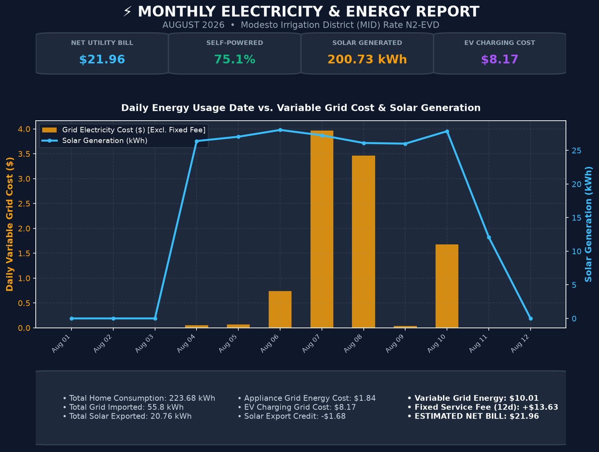

# Smart EV Charger ⚡☀️

A Python daemon on a home NAS that charges the EV from solar and the Tesla Powerwall, avoids on-peak
rates, and is run day to day from Telegram.

## How it works

Every 15 minutes it reads the Powerwall (NetZero API) and the ChargePoint Home Flex, then:

- **Starts** charging inside today's **charge window** when the Powerwall is at or above the **start %**.
- **Stops** when the Powerwall drops below the **stop %** or the window ends. Solar readings don't start or stop it.
- **Never** charges below the 15% critical reserve, when the Powerwall is off-grid or in storm mode, or in a
  weekday night blackout if you set one (the planner clears it each morning).

At **07:00** (or on `/plan`) an AI planner sets the window and the start/stop %. It uses the last 7 days'
hourly solar, the Powerwall's current level, evening needs and today's rates. The window is kept between 06:00
and 17:00 (the start of on-peak).

**Miles goals** (*"add 100 miles by tomorrow"*): the window is used first; only the shortfall charges at the
cheapest night rate. The goal clears itself when met or expired.

## Quick start

Needs Python 3.13+ (the image uses 3.14), a NetZero API token, a ChargePoint account, a Telegram bot token and
a Google service account with edit access to your sheet.

```bash
cp .env.example .env            # fill in the credentials
# put the service account key next to it as service_account.json
docker compose up -d --build    # or, without Docker: pip install -r requirements.txt && python main.py
```

For the NAS, `./build_docker.sh` builds the image (default `linux/amd64`).

## Using it (Telegram)

| Command / message | What it does |
| :--- | :--- |
| `/status` | Instant status card: car, Powerwall, solar, window, rate, goal (no AI needed) |
| `/stop`, `/auto` | Stop charging now / hand control back to automation (no AI needed) |
| `/plan` | Run the planner now: window, start/stop %, appliance tip |
| `/update` | Pull the latest code from `main` and restart (~10 s) |
| `/logs 30 ERROR` | Recent events / errors |
| `/model` | Show or switch the AI model |
| `/bill` | Monthly bill infographic |
| *"Add 100 miles by tomorrow"* | Set a miles goal |
| *"Charge at 32A until 16:00"* | Manual boost with an auto-stop (an hour already past means tomorrow) |
| *"How many miles did I add today?"* | Miles, kWh and cost |
| *"Alert me when the battery hits 80%"* | One-off custom alert |
| *"Investigate why charging stopped and fix it"* | Dev agent: reads logs and code, opens a GitHub PR (needs `GITHUB_TOKEN`) |
| `/clear` | Forget the chat history |

The slash commands also appear in Telegram's `/` menu. A manual start or stop pauses automation until `/auto`
or the daily reset (the blackout end hour, midnight once the planner has run).

A stop message includes the session's time, kWh and miles. With a miles goal active and the car unplugged,
you get one "plug in" reminder a day.

Every start sends a 🟢 message: a **planned restart** or an **⚠️ unexpected stop** (crash, out-of-memory,
power loss), with downtime, code version and NAS memory.

Web dashboard: `http://<nas>:8080`. Set `DASHBOARD_TOKEN` to protect it, then open it with `?token=<value>`.

`/bill` sends an infographic like this:



## Deploying changes

The image holds only `.env` and `service_account.json`. On every start, `entrypoint.sh` pulls `origin/main`
and runs `pip install`.

- **Code change:** push to `main`, then send `/update`. No rebuild is needed.
- **New `.env` value:** needs an image rebuild (`./build_docker.sh`, then redeploy). Avoid this: give new
  settings a default in `core/config.py`, or make them runtime-tunable (below).

## Settings

Most are set in `.env` (see `.env.example`). These can be changed live and are stored in the Google Sheets
**Settings** tab, which overrides `.env`:
`BATTERY_START_PCT` / `BATTERY_STOP_PCT` / `BATTERY_LOW_RESERVE_PCT`, `ALLOWED_CHARGE_START_HOUR` / `END_HOUR`,
`NIGHT_BLACKOUT_*`,
`LLM_PROVIDER` / `LLM_MODEL`, `MANUAL_MODE_OVERRIDE`, `EV_MILES_PER_KWH`, `CHECK_INTERVAL_MINUTES`.

| Key `.env` values | Purpose |
| :--- | :--- |
| `NETZERO_*`, `CHARGEPOINT_*`, `TELEGRAM_*` | API credentials (required) |
| `LLM_PROVIDER`, `LLM_MODEL`, `NVIDIA_API_KEY`, `GEMINI_API_KEY` | AI model (NVIDIA Nemotron, with Gemini as fallback) |
| `UTILITY_PROVIDER` | Rate plan: `MID` (default) or `PGE`. Any other name uses MID's energy rates with your own `UTILITY_*` fees |
| `PUSHOVER_*`, `GITHUB_TOKEN` | Optional: Pushover notifications; dev-agent pull requests |
| `POWERWALL_USABLE_KWH`, `EV_MILES_PER_KWH` | 13.5 kWh, 3.53 mi/kWh |

Google Sheets also holds **Telemetry** (~62 days of 15-minute readings) and **System Logs** (last 500 events).
Telemetry is also written to `logs/charger_log.csv`, which is used when Sheets is unreachable.

## Code map

| Path | What's there |
| :--- | :--- |
| `main.py` | Scheduler and the 15-minute control cycle |
| `core/decision.py` | Start/stop rules (pure function, easiest place to change behaviour) |
| `core/config.py`, `core/state.py` | Settings (env → Sheets) and runtime state |
| `core/tou.py`, `core/goal.py`, `core/lifecycle.py` | Rates, miles goals, startup notice |
| `core/sensors.py` | Night-time clean-up of Powerwall readings (live and logged) |
| `agent/daily_agent.py` | Morning planner prompt and validation |
| `agent/telegram_bot.py`, `agent/llm_client.py` | Telegram bot, AI tools, model fallback |
| `agent/alerts.py`, `agent/dev_agent.py` | Custom alerts; the code-fixing dev agent |
| `services/` | NetZero, ChargePoint and Google Sheets clients |
| `reporting/` | Telemetry, energy/bill analytics, notifications |
| `dashboard/` | Web dashboard |

## Development

```bash
python3 -m venv .venv && source .venv/bin/activate
pip install -r requirements.txt -r requirements-dev.txt
ruff check .
python -m unittest discover -s tests -t .
```

Tests run offline and never touch the live sheet. Each test file starts with `import tests` (kept first by
`# isort: split`), which points Sheets at a fake credentials file. CI runs the same lint and tests on every
push and PR.

## Security

- `.env` and `service_account.json` are git-ignored but baked into the image. Never push or share the image
  (or build with `--build-arg EMBED_SECRETS=0` and mount them instead).
- The bot only answers `TELEGRAM_ALLOWED_USER_ID`, and stays off if that is unset. Treat that account as root:
  through the dev agent it can run shell commands in the container.
- Without `DASHBOARD_TOKEN` the dashboard is readable by anyone on your network. It is read-only.
